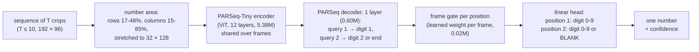

# Temporal jersey number recognition: report

All numbers below come from `results/compare/table.csv`, the runs' `metrics_val.json` / `metrics_test.json`
and `reproduce.log`, made by one run of `reproduce.sh` with one code version.

## Summary

- **Final model** (`parseq_gate`: PARSeq-Tiny per frame plus a learned frame gate per digit position):
  **96.4% of the 866 test sequences** are read correctly, 96.4% of the single digits and 96.4% of the
  two-digit numbers (always guessing 8 gets 35%).
- **The sequence beats a single frame:** the anchor (the clearest frame) read alone gets 84.4% on test,
  and a vote of the frames read one by one 94.7%. Accuracy rises from 85% after one frame to 95-96%
  after four or five.
- **A number never seen in training:** with 49 held out of training, the final approach reads it right
  59 times in 105 (val players) and 11 in 16 (test players). The plain two-digit baseline (`fused`) reads
  it 0 times, and the best lightweight two-step reader 26 times in 105.
- **Not solved yet:** a 4 in the *first* position (only 13 training sequences, all 48) is still the
  main error on held-out 49 (read as 99 or 89). Digits 0, 1, 2, 3, 5 and 7 are not in the data at all.

## Data

The dataset has 10 numbers: 4, 6, 8, 9, 48, 49, 64, 66, 88 and 89. About 95% of the 5,832 sequences
have one digit, and only five two-digit numbers exist. A first 4 appears only in 48 (13 training
sequences), and 64 and 88 have 1-3 sequences per split. Kit colour predicts the number: a linear
classifier on colour histograms alone gets 65% of val numbers right (`evaluate.py`, shortcut checks).

No test folder was supplied, so `prepare.py` splits by player, 70/15/15 per number (4,110 / 856 / 866
sequences). Players linked by identical images or by two numbers go to train, so no val or test image
was seen in training. Val and test players still share kits and matches with train, so the scores likely
overstate a new team.

## Model architecture

The final model, `parseq_gate` (6.0M parameters, 22.9 MB):

- **Per frame:** the number area of each frame is cut out and stretched to PARSeq's 32 × 128 text line.
  The encoder turns it into 4 × 8-pixel patches; two position queries of the decoder each attend over
  the patches and give one feature per position. The queries are read in one step, not one after the
  other, so digit 2 is read from the image, never predicted from digit 1.
- **Temporal component:** per digit position, a small gate (Linear-Tanh-Linear, after Ilse et al. 2018)
  scores each frame's feature; the softmax over the real frames weighs them. Blurred, occluded or turned
  frames can get little weight, and each position picks its own best frames. The head is linear, so this
  is a weighted mean of the frames' scores. Padding frames are masked out.
- **Output:** two positions with one shared head. Position 1 is a digit 0-9; position 2 is a digit or
  BLANK (PARSeq's "end"). The answer is the most likely pair, its probability the confidence.

The lightweight alternative compared below, the **two-step reader** (0.36-0.51M parameters), is a
MobileNetV3-Small (first 9 blocks) with three attention queries (single, left, right): deep features
decide *where* to look and *how many* digits there are, local features alone *what* digit is there.
`jersey/model.py` documents every reader and frame combiner.

## Generalisation to 00-99

A 100-class label can never output a number that has no training class. Here every number is two
positions, each a digit 0-9 or BLANK, read by one shared classifier. A 9 learned anywhere counts
everywhere, so 94 is "a 9, then a 4" even with no 94 in training.

The structure alone is not enough on this data. Each was measured with 49 held out of training
(`results/compare/holdout.png`):

| Reader (49 held out) | Held-out 49 right, val players (105) | Test players (16) | What it answers instead |
|---|---|---|---|
| `fused`: two digit heads on whole-crop features | **0** | 0 | 48, 69, 6, 9 |
| `two_step_*`: where-then-what, spliced pairs | 23-26 | 4-6 | 9, 99, 89 |
| `parseq_gate`: pretrained text reader | **59** | **11** | 99, 89 |

- **`fused`** reads the two-digit numbers it was trained on well (87%) but never 49: each head sees the
  whole crop, so it learns 48, 66 and 89 as whole pictures.
- **The two-step reader** adds locality, and **spliced pairs** teach it digit by digit: two single digits
  from players with a similar kit are cut out by their digit boxes and put side by side. The boxes need
  no annotation: a local digit reader proposes where the digit is, an ink check (colour clustering)
  proposes a box, and a box is kept only if they agree (95 of 100 checked by eye). Single digits are
  pasted the same way, so a pasted patch is not a cue for "two digits". This takes held-out 49 from
  none to a quarter, but real two-digit shirts drop to 54-62%.
- **PARSeq-Tiny** learned every digit in every position from millions of text images, so it is
  fine-tuned on the real data only, with no pastes. Each position is read from the image alone, so no
  whole-number prior can rule out 49. It reads 56% of held-out 49 (95% interval 47-65%); the second
  digit is right 81% of the time, the first only 56%.

**Limit:** this data holds only the digits 4, 6, 8 and 9. The output has 0-9, and PARSeq saw every digit
in pretraining, but 0, 1, 2, 3, 5 and 7 are never fine-tuned or tested here. 10, 23 or 77 need examples
of those digits, in any position and any number. Unseen *combinations* of known digits are measured;
unseen *digits* are not.

## Training and optimisation

**Data loading.**
- Each item is up to 10 frames in time order: picked at random in training, spread evenly in
  evaluation, zero-padded, with a mask.
- The same augmentation is applied to every frame of a sequence. It randomises colour, since colour
  predicts the number here, and adds mild geometry, blur, low resolution and JPEG.
- The **anchor** is only an extra training example: the same loss on the anchor read alone, at half
  weight. It is never an input of the sequence model, and `predict.py` ignores it.
- Rare numbers are drawn more often (weight count^-0.5).

**Optimisation (final model).** One stage of 15 epochs, AdamW with a OneCycle schedule, 1e-4 for the
decoder, gate and head and 1e-5 for the pretrained encoder, batch 32, cross-entropy on both positions.
The best epoch by val loss is kept (epoch 13). About 22 minutes on an M-series GPU (MPS).

**Two-step readers** train in two stages: (1) singles and pastes without real two-digit sequences,
judged on spliced val pairs; (2) all real data at a tenth of the rates, judged on val loss. Their count
head weighs one and two digits equally, so a **count prior** log(one-digit / two-digit numbers in
training) = 3.05 corrects it for the real mix: for `two_step_pool` it lifts val accuracy from 0.88 to 0.94,
while two-digit numbers drop from 0.72 to 0.54. PARSeq has no count head and needs no prior.

**Lightweight.**

| | Parameters | Weights | ms per 10-frame sequence (1 CPU thread) |
|---|---|---|---|
| `parseq_gate` (final) | 6.0M (encoder 5.38M, decoder 0.60M, gate 0.02M) | 22.9 MB | 36 |
| `two_step_pool` | 0.37M | 1.5 MB | 23 |
| `fused` | 0.30M | 1.2 MB | 23 |

PARSeq-Tiny is the smallest PARSeq, inputs are 32 × 128, the decoder reads both positions in one pass,
and the gate adds 0.02M. It is 16 times the two-step reader in size but only 1.5 times slower, and still
real time for a tracker. The two-step reader is the choice where memory matters more than 2-3 points of
accuracy.

## Results

**Selection.** Six approaches were trained with 49 held out; the final approach is the one with the best
val macro accuracy (numbers with ≥ 5 sequences), chosen on val only. It was then retrained on all ten
numbers, and every run was scored on the test split once.

| Run (49 held out) | Val acc. | Two-digit | Macro ≥5 | Held-out 49 (val) | Anchor alone | Frame vote | Test acc. | Held-out 49 (test) |
|---|---|---|---|---|---|---|---|---|
| `single_frame` (two-step, 1 frame) | 0.815 | 0.205 | 0.603 | 0.105 | 0.836 | 0.815 | 0.815 | 2/16 |
| `fused` | 0.867 | 0.872 | 0.882 | 0.000 | 0.706 | 0.849 | 0.875 | 0/16 |
| `two_step_mean` | 0.932 | 0.590 | 0.861 | 0.219 | 0.827 | 0.924 | 0.928 | 5/16 |
| `two_step_pool` | 0.942 | 0.538 | 0.852 | 0.248 | 0.832 | 0.929 | 0.920 | 4/16 |
| `two_step_full` | 0.935 | 0.615 | 0.877 | 0.248 | 0.829 | 0.925 | 0.928 | 6/16 |
| **`parseq_gate`** | **0.960** | **0.949** | **0.975** | **0.562** | 0.893 | 0.949 | **0.959** | **11/16** |

Val and test agree within about one point for every run, so the choice on val did not inflate the score.

**Final model on the test split** (`parseq_gate_all`, 866 sequences, 95% Wilson intervals):

| Number | 4 | 6 | 8 | 9 | 48 | 49 | 64 | 66 | 88 | 89 |
|---|---|---|---|---|---|---|---|---|---|---|
| Right | 156/161 | 123/128 | 290/303 | 213/219 | 3/3 | 16/16 | 1/1 | 21/21 | 0/1 | 12/13 |
| Accuracy | 0.969 | 0.961 | 0.957 | 0.973 | 1.00 | 1.00 | 1.00 | 1.00 | 0.00 | 0.923 |
| 95% interval | 0.93-0.99 | 0.91-0.98 | 0.93-0.97 | 0.94-0.99 | 0.44-1 | 0.81-1 | 0.21-1 | 0.85-1 | 0-0.79 | 0.67-0.99 |

Overall 0.964; the four single digits together 0.965 (0.950-0.976); macro ≥5 0.969. The errors are mostly digits of
similar shape: 8 → 4 (6), 4 → 8 (5), 6 → 8 (5), 9 → 8 (5). Here 49 is in training, so 16/16 is not a
generalisation result; only the held-out runs measure that.

**Curves** (`results/compare/curves_parseq_gate_all.png`): val loss falls from 1.04 (the untrained
gate and head) to 0.074 at epoch 13 and is flat after epoch 10; train-check and val loss stay together,
so there is no overfitting. The running training loss is higher only because training images are
augmented. Val macro accuracy over *all* numbers (0.83) is pulled down by 88, which has one val sequence.
`results/compare/curves.png` shows every approach.

**It reads the digits, not the kit** (val, final model): covering the number area drops accuracy from
0.964 to 0.141, below always guessing 8 (0.371); showing only the number area keeps 0.964; grayscale
keeps 0.961.

## Temporal stability: sequence vs anchor

From `results/compare/temporal.png` and `stability` in the metrics files:

| | Val | Test |
|---|---|---|
| Sequence model (up to 10 frames) | 0.964 | 0.964 |
| Frame vote (frames read alone, then a majority) | 0.956 | 0.947 |
| Anchor alone | 0.887 | 0.844 |

- **Accuracy after the first k frames** (test, the 650 sequences with at least 5 frames): 0.854, 0.918, 0.942,
  0.957, 0.954 for k = 1-5. Most of the gain comes from the second and third frame.
- **Stability:** read frame by frame, the single-frame answers disagree within 35% of sequences. The
  sequence model's answer, recomputed as frames arrive, never changes in 85% of sequences (0.20 changes
  per sequence on average).
- **The temporal component on its own:** the same two-step reader gets 0.815 with one frame and 0.932
  with ten (val). How the frames are combined matters much less: mean, learned gate and a transformer
  layer are within one point (0.932 / 0.942 / 0.935 val, 0.928 / 0.920 / 0.928 test), inside the noise.
  The gate was kept for PARSeq because it is as cheap as the mean and lets each position pick its frames.

Why: a single frame can be blurred, occluded or turned; several frames give the digit more chances to
be seen, and the gate weighs them.

## Next steps

- **Data:** every digit 0-9, in both positions; real two-digit numbers per digit pair, and more
  4-first shirts, the main remaining error.
- **A real test set:** another team, league or camera, since val and test share kits with train.
- **Count prior per league** for the two-step reader: set the expected share of two-digit numbers
  (`predict.py --two-digit-share`).
- **Latency:** fewer frames (four already give 0.957), an early stop once the answer is stable, int8
  quantisation of the encoder, and caching each frame's reading across a track.
- **Smaller model:** distil the PARSeq reader into the two-step network, using it to label pasted and
  real crops.

## Honest limits

- Two-digit numbers are rare (55 test sequences), so their scores have wide intervals.
- The hold-out tests only 49, and on the test split only 16 sequences (11/16: interval about 0.44-0.86).
- The test split is our own player split, not a provided test folder.
- Each approach was trained once (seed 0); differences of one to two points are within run-to-run noise.
