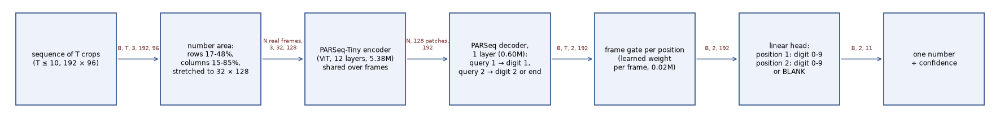
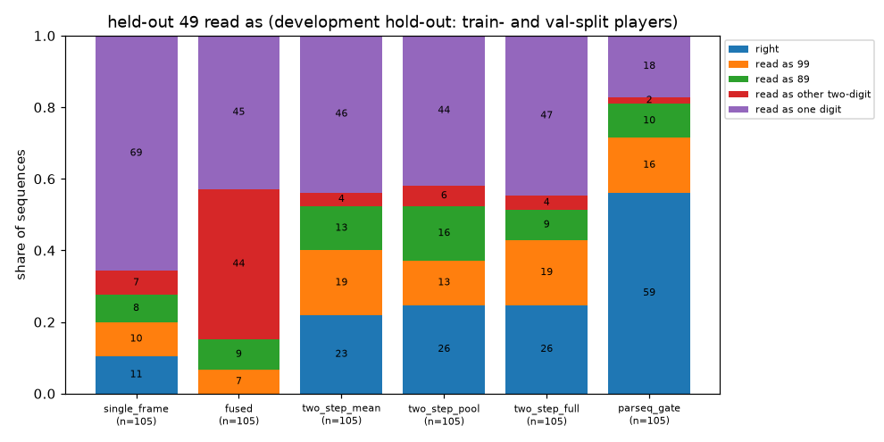
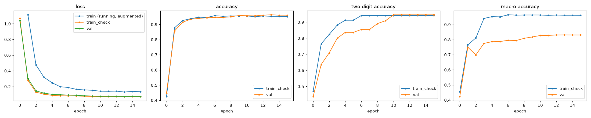
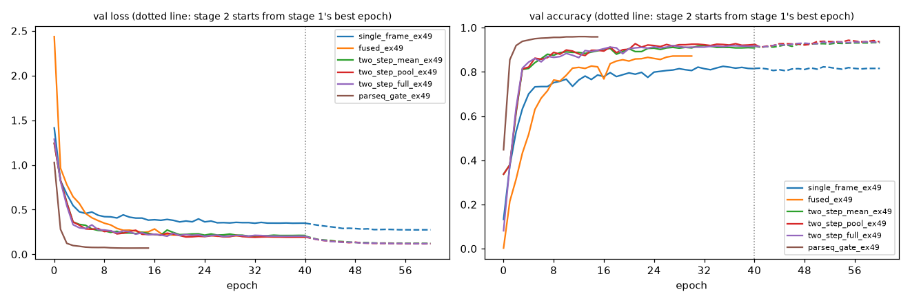
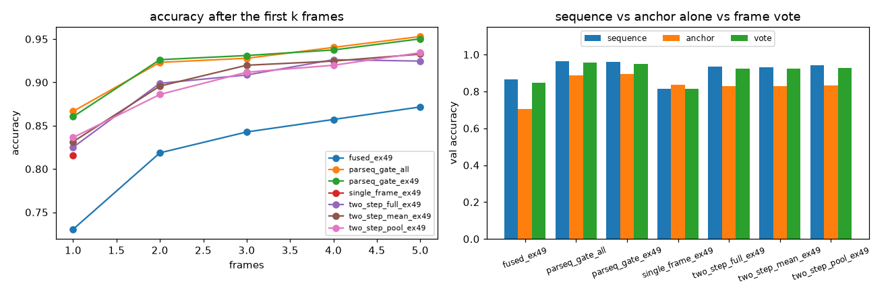

# Temporal jersey number recognition: report

**Where the numbers come from.** Every number below comes from these files: `results/compare/table.csv`, `results/compare/analysis_parseq_gate_all.json`, and each run's `config.json`, `history.json`, `metrics_*.json` and `predictions_*.csv` (all committed under `results/runs/`, without weights), plus `reproduce.log`.

- **Code.** The ladder runs and the final model were trained with the code of commit b96b094. Their scores were made with the evaluation code of 714c0ee, which only changed plotting.
- **How they were run.** `reproduce.sh` trained and scored all of them, except `parseq_gate_ex49`. That run was trained with the same `train.py` command and the same code just before the script started, and the script then skipped it (`reproduce.log`, line 354).
- **Later runs.** The two extra seeds and the random-start run came after the review, from commits 167d2c1 and 2d81b72. They change only `config.json` fields, run names and plots, not training.
- **Provenance.** Every run's `config.json` now records the git commit and whether tracked code had uncommitted changes.

**Compute.** Everything ran on an Apple M4 Pro (MPS). The reported runs took about 3.7 hours: about 42 minutes for `parseq_gate_ex49`, then 2 h 55 min for `reproduce.sh`. The three extra runs took 1 h 36 min. MPS training is not bit-for-bit deterministic, so a rerun gives slightly different numbers. The shipped weights reproduce the recorded test answers exactly, 866 of 866 (`uv run evaluate.py --verify weights/final`).

## Summary

- **Final model** (`parseq_gate`: PARSeq-Tiny on each frame, plus a learned frame gate per digit position):
  - It reads **96.4% of the 866 test sequences** correctly: 96.4% of the single digits and 96.4% of the two-digit numbers.
  - Always guessing 8 gets 35%.
  - The 95% interval is 0.951–0.976 when whole tracks are resampled.
- **The sequence beats a single frame:**
  - The anchor read alone gets 84.4% on test, and so does the first frame alone (85.0%).
  - A vote of the frames, each read on its own, gets 94.7%.
  - Both gaps are significant on paired tests: against the anchor, 120 vs 16 sequences where only one is right, p < 10⁻²⁰; against the vote, 19 vs 4, p = 0.003.
- **A number never seen in training.** With 49 held out of training, the final approach reads **11 of the 16 test-split 49s** (95% interval 0.44–0.86). That is the clean estimate.
  - On the development hold-out (the 49s of train- and val-split players, which were looked at during development), it reads 59 of 105.
  - Over seeds 0, 1 and 2, the test result is 11, 11 and 10 of 16, and the development result 59 of 105 every time.
  - The plain two-digit baseline (`fused`) reads 0 of these numbers, and the best lightweight two-step reader 26 of 105.
- **Most of that comes from pretraining.** PARSeq's text pretraining saw every digit in every position.
  - The same model started from random weights reads 0 of 105 and 0 of 16, and only 46% of val overall.
  - See [Use of pretrained weights](#use-of-pretrained-weights).
- **Not solved yet:**
  - A 4 in the *first* position (only 13 training sequences, all 48) is still the main error on held-out 49: it is read as 99 or 89.
  - Digits 0, 1, 2, 3, 5 and 7 are not in the data at all.

## Data

**The numbers.**

- The dataset has 10 numbers: 4, 6, 8, 9, 48, 49, 64, 66, 88 and 89.
- About 95% of the 5,832 sequences have one digit, and only five two-digit numbers exist.
- A first 4 appears only in 48 (13 training sequences). 64 and 88 have 1–3 sequences per split.
- Kit colour predicts the number: a linear classifier on colour histograms alone gets 65% of val numbers right (`evaluate.py`, shortcut checks).

**The split.**

- No test folder was supplied, so `prepare.py` splits **by track folder**, 70/15/15 per number (4,110 / 856 / 866 sequences).
- Each player folder (`<a>_<b>`) is one track: its second part is unique.
- Its first part is shared across numbers, so it most likely names the match or video. That is an inference; the data does not document it.
- Folders linked by identical images, or by two numbers, go to train, so no val or test image was seen in training.

**Same match, different splits.**

- The same player in the same match can still be in train and test under two track folders. For example, `1003_15408` (#4) is in val and `1003_19783` (#4) is in train.
- 733 of the 866 test sequences come from a match that is also in train.
- The overlap does not appear to inflate the score (final model, test, 95% Wilson intervals):

| Test sequences | Count | Right | Accuracy (95% interval) |
|---|---|---|---|
| Match never in train | 133 | 131 | 0.985 (0.947–0.996) |
| Match in train, other number only | 406 | 387 | 0.953 (0.928–0.970) |
| Same match and same number in train | 327 | 317 | 0.969 (0.945–0.983) |

Val and test still share kits and leagues with train, so a new team or camera may score lower.

## Model architecture

The final model, `parseq_gate` (6.0M parameters, 22.9 MB). The tensor shape is on each arrow. N is the number of real frames, at most B × T. A rendered copy is in `results/compare/architecture.png`:

```mermaid
flowchart LR
    S["sequence of T crops<br/>(T ≤ 10, 192 × 96)"] -->|"B, T, 3, 192, 96"| C["number area:<br/>rows 17-48%, columns 15-85%,<br/>stretched to 32 × 128"]
    C -->|"N, 3, 32, 128"| E["PARSeq-Tiny encoder<br/>(ViT, 12 layers, 5.38M)<br/>shared over frames"]
    E -->|"N, 128 patches, 192"| D["PARSeq decoder, 1 layer (0.60M):<br/>query 1 → digit 1,<br/>query 2 → digit 2 or end"]
    D -->|"B, T, 2, 192"| G["frame gate per position<br/>(learned weight per frame,<br/>0.02M)"]
    G -->|"B, 2, 192"| H["linear head:<br/>position 1: digit 0-9<br/>position 2: digit 0-9 or BLANK"]
    H -->|"B, 2, 11"| N["one number<br/>+ confidence"]
```

- **Per frame:**
  - The number area of each frame is cut out and stretched to PARSeq's 32 × 128 text line.
  - The encoder turns it into 4 × 8-pixel patches. Two position queries of the decoder each attend over the patches and give one feature per position.
  - The queries are read in one step, not one after the other, so digit 2 is read from the image and never predicted from digit 1.
- **Temporal component:**
  - For each digit position, a small gate (Linear-Tanh-Linear, after Ilse et al. 2018) scores each frame's feature, and a softmax over the real frames turns the scores into weights.
  - Each position picks its own frames. Padding frames are masked out.
  - On val, in sequences where some frames are read right at a position and some wrong, frames read right get more weight. With 1 meaning a uniform weight, they get 1.07 vs 0.79 in position 1 (258 sequences) and 1.03 vs 0.89 in position 2 (66 sequences). So the gate leans away from frames it misreads, but only mildly.
  - The head is linear, so this is a weighted mean of the frames' scores.
- **Output:**
  - There are two positions and one shared head. Position 1 is a digit 0–9; position 2 is a digit or BLANK (PARSeq's "end").
  - The answer is the most likely pair, and its probability is the confidence.

The lightweight alternative, the **two-step reader** (0.36–0.51M parameters), is a MobileNetV3-Small (first 9 blocks) with three attention queries: single, left and right.

- Deep features decide *where* to look and *how many* digits there are.
- Local features alone decide *what* digit is there.
- `jersey/model.py` documents every reader and frame combiner. `jersey/pairs.py`, which finds digit boxes and makes spliced pairs, only serves this reader.

## Generalisation to 00-99

A 100-class label can never output a number that has no training class. Here every number is two positions, each a digit 0–9 or BLANK, read by one shared classifier. A 9 learned anywhere counts everywhere, so 94 is "a 9, then a 4" even with no 94 in training.

The structure alone is not enough on this data. Each reader was measured with 49 held out of training (`results/compare/holdout.png`, which shows the development hold-out):

| Reader (49 held out) | Dev. hold-out: train-split players (89) | Dev. hold-out: val-split players (16) | **Test players (16)** | What it answers instead |
|---|---|---|---|---|
| `fused`: two digit heads on whole-crop features | 0 | 0 | **0** | 48, 69, 6, 9 |
| `two_step_*`: where-then-what, spliced pairs | 19–23 | 3–4 | **4–6** | 9, 99, 89 |
| `parseq_gate`: pretrained text reader | 53 | 6 | **11** | 99, 89 |

The two development groups were used for decisions during development, so only the test column is a clean estimate. The 49s of the train split are held-out *players* of a held-out *number*; they never enter training.

- **`fused`** reads the two-digit numbers it was trained on well (87%) but never 49. Each head sees the whole crop, so it learns 48, 66 and 89 as whole pictures.
- **The two-step reader** adds locality, and **spliced pairs** teach it digit by digit:
  - Two single digits from players with a similar kit are cut out by their digit boxes and put side by side.
  - The boxes need no annotation. A local digit reader proposes where the digit is, an ink check (colour clustering) proposes a box, and a box is kept only if the two agree. 95 of 100 checked by eye were right.
  - Single digits are pasted the same way, so a pasted patch is not a cue for "two digits".
  - This takes held-out 49 from none to a quarter, but real two-digit shirts drop to 54–62%.
- **PARSeq-Tiny** learned every digit in every position from text images, so it is fine-tuned on the real data only, with no pastes.
  - Each position is read from the image alone, so no whole-number prior can rule out 49.
  - On the development hold-out, the second digit is right 81% of the time and the first only 56%.

**The intervals are optimistic.** Wilson intervals treat every sequence as independent, but the 105 development sequences come from 80 tracks and the 16 test ones from 14. Resampling whole tracks gives wider intervals:

- `parseq_gate`: 0.46–0.67 on development and 0.44–0.88 on test;
- `two_step_pool`: 0.16–0.34 on development and 0.06–0.50 on test.

**Limit:** this data holds only the digits 4, 6, 8 and 9.

- The output has 0–9, and PARSeq saw every digit in pretraining, but 0, 1, 2, 3, 5 and 7 are never fine-tuned or tested here.
- Reading 10, 23 or 77 needs examples of those digits, in any position and any number.
- Unseen *combinations* of known digits are measured; unseen *digits* are not.
- One indirect sign: fine-tuning barely moved PARSeq's output layer. Every row, including those of the never-seen digits 0, 1, 2, 3, 5 and 7, keeps a cosine similarity of at least 0.997 to the released weights, so the outputs for unseen digits are intact. How far the encoder drifted is not measured.

## Use of pretrained weights

The brief asks for a model "trained on only the given jersey number data". No jersey images other than the given data were used anywhere. Two parts start from public pretrained weights:

- **MobileNetV3-Small** (two-step and fused readers): ImageNet classification weights from torchvision.
- **PARSeq-Tiny** (final model): the released scene-text weights of Bautista & Atienza, *Scene Text Recognition with Permuted Autoregressive Sequence Models*, ECCV 2022 (baudm/parseq, release v1.0.0, Apache-2.0; see `LICENSE-parseq` and `NOTICE`).
  - The PARSeq repository trains on public scene-text datasets, either real ones (ArT, COCO-Text, LSVT, MLT19, OpenVINO, RCTW17, ReCTS, TextOCR, Uber-Text) or synthetic ones (MJSynth, SynthText).
  - Its README does not say which set the released checkpoints used.
  - None of these are jersey crops from this task.

How much of the held-out result is pretraining? The same `parseq_gate` recipe, 49 held out, started from random weights (`parseq_gate_ex49_scratch`):

| `parseq_gate`, 49 held out | Val accuracy | Two-digit | Dev. hold-out (105) | Test hold-out (16) |
|---|---|---|---|---|
| PARSeq pretrained weights, seed 0 | 0.960 | 0.949 | 59 | 11 |
| PARSeq pretrained weights, seed 1 | 0.960 | 0.949 | 59 | 11 |
| PARSeq pretrained weights, seed 2 | 0.957 | 0.949 | 59 | 10 |
| Random start (`--no-pretrained`) | 0.462 | 0.513 | 0 | 0 |

- **Seeds:** the held-out result does not depend on the seed. All three seeds read the same 59 of 105 development sequences right, and 10–11 of the 16 test ones.
- **Random start:** from random weights, the same network and recipe never learn to read in 15 epochs. They answer 6 or 8 for almost everything: 0.462 on val and 0.409 on test, barely above always guessing 8 (0.379).
  - A 6M-parameter ViT needs far more than 4,110 sequences, or far more epochs, to learn digits from scratch.
  - So the final model's ability to read an unseen number comes from PARSeq's pretraining, combined with the two-position output that lets it use that ability. The structure without pretraining (`fused`, 0 of 105) does not manage it.
  - On this data, the honest claim is: **the structure makes 00–99 *possible*; pretraining makes it *work*.**

**Two recommended models**, with their trade-off:

| | Accuracy (test) | Held-out 49 (test) | Size | Outside data |
|---|---|---|---|---|
| `parseq_gate` (shipped) | 0.964 (all numbers) | 11/16 | 6.0M parameters, 22.9 MB | ImageNet-free; PARSeq scene-text pretraining |
| `two_step_pool` | 0.920 (49 held out) | 4/16 | 0.37M parameters, 1.5 MB | ImageNet only |

PARSeq is the choice for accuracy. `two_step_pool` is the choice when outside text pretraining is not allowed, or when memory matters more than 3–4 points of accuracy.

## Training and optimisation

**Data loading.**

- Each item is up to 10 frames in time order: picked at random in training, spread evenly in evaluation, zero-padded, with a mask.
- The same augmentation is applied to every frame of a sequence. It randomises colour, since colour predicts the number here, and adds mild geometry, blur, low resolution and JPEG.
- The **anchor** is only an extra training example: the same loss on the anchor read alone, at half weight. It is never an input of the sequence model, and `predict.py` ignores it.
  - The anchor is a separate crop, not one of the frames: in 300 random sequences only 4 anchors are within a mean pixel difference of 5/255 of any of their frames (median 23/255).
- Rare numbers are drawn more often (weight count^-0.5).

**Optimisation (final model).**

- One stage of 15 epochs with AdamW and a OneCycle schedule, batch 32, cross-entropy on both positions.
- Learning rates: 1e-4 for the decoder, gate and head, 1e-5 for the pretrained encoder.
- The best epoch by val loss is kept (epoch 13).
- About 22 minutes on the M4 Pro GPU (MPS).

**Two-step readers** train in two stages:

1. Singles and pastes, without real two-digit sequences, judged on spliced val pairs.
2. All real data at a tenth of the rates, judged on val loss. Stage 2 starts from stage 1's best epoch.

Their count head weighs one and two digits equally. A **count prior**, log(one-digit / two-digit numbers in training) = 3.05, corrects it for the real mix:

- For `two_step_pool` it lifts val accuracy from 0.88 to 0.94, while two-digit numbers drop from 0.72 to 0.54.
- PARSeq has no count head and needs no prior. `predict.py --two-digit-share` applies to the two-step readers only.

**Lightweight.** Measured on one CPU thread of the M4 Pro:

| | Parameters | Weights | ms per 10-frame sequence | ms per frame | Val accuracy |
|---|---|---|---|---|---|
| `parseq_gate` (final) | 6.0M (encoder 5.38M, decoder 0.60M, gate 0.02M) | 22.9 MB | 36 | 3.6 | 0.964 |
| `parseq_gate`, 4 frames instead of 10 | same | 22.9 MB | 16 (4 frames) | 4.1 | 0.956 |
| `parseq_gate`, int8 linear layers | same | 6.9 MB | 166 | 16.6 | 0.963 |
| `two_step_pool` | 0.37M | 1.5 MB | 23 | 2.3 | 0.942 (49 held out) |
| `fused` | 0.30M | 1.2 MB | 23 | 2.3 | 0.867 (49 held out) |

- **Built in:** PARSeq-Tiny is the smallest PARSeq, inputs are 32 × 128, the decoder reads both positions in one pass, and the gate adds 0.02M.
- **Measured here:**
  - **Fewer frames:** 4 frames cost 0.8 points of val accuracy and take 16 ms instead of 37 ms per sequence (measured in the same session; the table's 36 ms is the run's own measurement).
  - **Dynamic int8 quantisation** of every linear layer (the ViT is mostly linear layers) cuts the weights from 22.9 to 6.9 MB at −0.1 points. With PyTorch's qnnpack kernels on this CPU it is about 4 times slower (166 vs 38 ms), so it helps memory, not speed.
- **Overall:** PARSeq is 16 times the two-step reader in size but only 1.5 times slower, and still real time for a tracker.

## Results

**Selection.** Six approaches were trained with 49 held out. The final approach is the one with the best val macro accuracy (numbers with ≥ 5 sequences), chosen on val only. It was then retrained on all ten numbers, and every run was scored on the test split once.

| Run (49 held out) | Val acc. | Two-digit | Macro ≥5 | Dev. hold-out (105) | Anchor alone | Frame vote | Test acc. | Test macro ≥5 | Test hold-out (16) |
|---|---|---|---|---|---|---|---|---|---|
| `single_frame` (two-step, 1 frame) | 0.815 | 0.205 | 0.603 | 11 | 0.836 | 0.815 | 0.815 | 0.607 | 2 |
| `fused` | 0.867 | 0.872 | 0.882 | 0 | 0.706 | 0.849 | 0.875 | 0.889 | 0 |
| `two_step_mean` | 0.932 | 0.590 | 0.861 | 23 | 0.827 | 0.924 | 0.928 | 0.798 | 5 |
| `two_step_pool` | 0.942 | 0.538 | 0.852 | 26 | 0.832 | 0.929 | 0.920 | 0.764 | 4 |
| `two_step_full` | 0.935 | 0.615 | 0.877 | 26 | 0.829 | 0.925 | 0.928 | 0.802 | 6 |
| **`parseq_gate`** | **0.960** | **0.949** | **0.975** | **59** | 0.893 | 0.949 | **0.959** | **0.972** | **11** |

**Val vs test:**

- Accuracy agrees within about two points for every run. The largest gap is `two_step_pool`, 0.942 vs 0.920.
- Macro accuracy differs more for the two-step readers (up to 9 points). It rests on the few two-digit sequences, so it is noisy.
- The chosen approach is the best on both splits, so choosing on val did not change the ranking.

**Final model on the test split** (`parseq_gate_all`, 866 sequences, 95% Wilson intervals):

| Number | 4 | 6 | 8 | 9 | 48 | 49 | 64 | 66 | 88 | 89 |
|---|---|---|---|---|---|---|---|---|---|---|
| Right | 156/161 | 123/128 | 290/303 | 213/219 | 3/3 | 16/16 | 1/1 | 21/21 | 0/1 | 12/13 |
| Accuracy | 0.969 | 0.961 | 0.957 | 0.973 | 1.00 | 1.00 | 1.00 | 1.00 | 0.00 | 0.923 |
| 95% interval | 0.93-0.99 | 0.91-0.98 | 0.93-0.97 | 0.94-0.99 | 0.44-1 | 0.81-1 | 0.21-1 | 0.85-1 | 0-0.79 | 0.67-0.99 |

- **Overall:** 0.964 (track-resampled interval 0.951–0.976). The four single digits together score 0.965 (0.950–0.976), and macro ≥5 is 0.969.
- **Errors:** they are mostly digits of similar shape: 8 → 4 (6), 4 → 8 (5), 6 → 8 (5), 9 → 8 (5).
- **The 16/16 on 49:** here 49 is in training, so it is not a generalisation result. Only the held-out runs measure that.

**Curves** (`results/compare/curves_parseq_gate_all.png`):

- Val loss falls from 1.04 (the untrained gate and head) to 0.074 at epoch 13, and is flat after epoch 10.
- Train-check and val loss stay together, so there is no overfitting. The running training loss is higher only because training images are augmented.
- The two-digit panel moves in steps because val has only 55 two-digit sequences: one sequence is 1.8 points.
- Val macro accuracy over *all* numbers (0.83) is pulled down by 88, which has one val sequence.

`results/compare/curves.png` shows the six held-out runs on the same val set. For the two-stage runs, stage 2 is drawn dashed after the dotted line, because it starts from stage 1's best epoch, not its last.

**It reads the digits, not the kit.** The cover checks (val) grey out the number area ("torso covered") or everything else ("only torso"). They only mean something for readers that see the whole crop:

- **`two_step_pool`:** covering the number area drops it from 0.942 to 0.227, below always guessing 8 (0.379). Showing only the number area keeps 0.925.
- **`fused`:** 0.867 → 0.254 covered, 0.738 with only the number area.
- **PARSeq:** it only ever sees rows 17–48% and columns 15–85%, which lie inside the covered box. So "only torso" is the same as unchanged by construction, and "covered" removes its whole input. For PARSeq, the informative check is **grayscale: 0.964 → 0.961**, so it does not lean on kit colour.

## Temporal stability: sequence vs anchor

From `results/compare/temporal.png` (the held-out runs, val), `stability` in the metrics files, and the paired tests in `analysis_parseq_gate_all.json`:

| Final model | Val | Test |
|---|---|---|
| Sequence model (up to 10 frames) | 0.964 | 0.964 |
| Frame vote (frames read alone, then a majority) | 0.956 | 0.947 |
| Anchor alone | 0.887 | 0.844 |
| First frame alone | | 0.850 |

**Paired tests on test** (exact McNemar, over the sequences where exactly one method is right):

| Comparison | Only the first right | Only the second right | p |
|---|---|---|---|
| Sequence vs anchor | 120 | 16 | < 10⁻²⁰ |
| Sequence vs frame vote | 19 | 4 | 0.003 |
| First frame vs anchor | 90 | 85 | 0.76 |

- **Why the sequence wins:**
  - On test, the first frame alone does as well as the hand-picked anchor (0.850 vs 0.844, no significant difference).
  - The gain comes from combining several views, not from picking a clear frame.
  - The learned combination also beats a plain vote of the same frames.
- **Accuracy after the first k frames** (test, the 650 sequences with at least 5 frames): 0.854, 0.918, 0.942, 0.957 and 0.954 for k = 1–5. Most of the gain comes from the second and third frame.
- **Stability:**
  - Read frame by frame, the single-frame answers disagree within 35% of sequences.
  - The sequence model's answer, recomputed as frames arrive, never changes in 85% of sequences (0.20 changes per sequence on average).
- **The temporal component on its own:**
  - The same two-step reader gets 0.815 with one frame and 0.932 with ten (val).
  - How the frames are combined matters much less: mean, learned gate and a transformer layer are within one point (0.932 / 0.942 / 0.935 val, 0.928 / 0.920 / 0.928 test), inside the noise.
  - The gate was kept for PARSeq because it is as cheap as the mean and lets each position pick its frames.

**Why it works:** a single frame can be blurred, occluded or turned, and several frames give the digit more chances to be seen. The gate gives frames it misreads somewhat less weight (see Model architecture).

## Next steps

- **Data:** every digit 0–9, in both positions; real two-digit numbers per digit pair; and more 4-first shirts, the main remaining error.
- **A real test set:** another team, league or camera, since val and test share kits with train.
- **Count prior per league** for the two-step reader: set the expected share of two-digit numbers (`predict.py --two-digit-share`).
- **Latency:**
  - fewer frames, or an early stop once the answer is stable;
  - caching each frame's reading across a track;
  - static int8 or a mobile runtime for real speed-ups, since dynamic int8 only saves memory here.
- **Smaller model:** distil the PARSeq reader into the two-step network, using it to label pasted and real crops.

## Honest limits

- Two-digit numbers are rare (55 test sequences), so their scores have wide intervals.
- The hold-out tests only 49. On the test split that is 16 sequences from 14 tracks (11/16: about 0.44–0.86).
- The test split is our own split by track folder, not a provided test folder, and most test matches also appear in train.
- The ladder was trained once (seed 0). The seed spread of the final approach is above, and differences of one to two points between the other approaches are within run-to-run noise.
- Most of the held-out result comes from PARSeq's outside text pretraining (see Use of pretrained weights).
