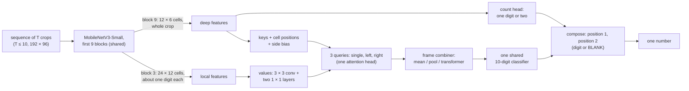

# Temporal jersey number recognition: report

> Sections marked **TODO** are filled from `results/compare/` after `reproduce.sh`.

## Summary

TODO: the result in three lines: test accuracy of the final model, sequence vs anchor alone, and
hold-out 49 against the plain two-digit baseline. Then what does not work yet.

## Data

The dataset has 10 numbers: 4, 6, 8, 9, 48, 49, 64, 66, 88 and 89. About 95% of the 5,832 sequences
have one digit, and only five two-digit numbers exist. A first 4 appears only in 48 (13 training
sequences), and 64 and 88 have 1-3 sequences per split. Kit colour predicts the number: a linear
classifier on colour histograms alone gets about 65% of val numbers right (`evaluate.py`, shortcut
checks).

No test folder was supplied, so `prepare.py` splits by player, 70/15/15 per number. Players linked by
identical images or by two numbers go to train, so no val or test image was seen in training. Val and
test players still share kits and matches with train, so the scores likely overstate a new team.

## Model architecture

- **Where, then what.** The deep features see the whole crop, so they decide *where* each query looks
  (keys) and *how many* digits there are (count). The local features see about one digit per cell,
  and only they give the content (values). The left query cannot read the right digit without
  looking at it.
- **Two positions, one digit classifier.** Position 1 is P(one) P_single(d) + P(two) P_left(d), and
  position 2 is P(two) P_right(d) or BLANK with P(one). Every position uses the same 10-digit classifier.
- **Temporal component.** Each frame is read alone, and the frame combiner joins the frames'
  readings: a mean, a learned weighted mean, or one transformer layer in which frames see each other.
- TODO: parameters per block, from `metrics_val.json` → `speed`.

## Generalisation to 00-99

A 100-class label can never output a number that has no training class. Here every number is two
positions, each a digit 0-9 or BLANK, read by one shared classifier. A 9 learned anywhere counts
everywhere, so 94 is "a 9, then a 4" even with no 94 in training.

The structure alone is not enough on this data:
- A reader whose two queries see whole-crop features (`fused`) never has to tell left from right,
  and it learns the few two-digit numbers whole. An earlier version read held-out 49 right 1 time
  in 105.
- The two-step reader adds locality, and **spliced pairs** teach it digit by digit. Two single
  digits from players with a similar kit are cut out by their digit boxes and put side by side.
  Every digit then shows up in both positions, and both digit boxes are known, so the left and
  right attention can be trained on them.
- The boxes need no annotation. A local digit reader proposes where the digit is, an ink check
  (colour clustering) proposes a box, and a box is kept only if they agree.
- A pasted patch could become a cue for "two digits", so single digits are pasted the same way too.

TODO: hold-out 49 for `fused_ex49` vs the `two_step_*_ex49` runs (`results/compare/holdout.png`).

**A pretrained text reader** (`parseq_gate`) takes the other road: PARSeq-Tiny learned every digit in
every position from millions of text images, so it is fine-tuned on the real data only, with no pastes.
Each position is read from the image alone, never from the digit before it, so no whole-number prior
can rule out 49. It is 6.0M parameters against about 0.37M, a trade-off the comparison has to weigh.
TODO: its val and hold-out scores against the two-step reader (`table.csv`).

**Limit:** this data holds only the digits 4, 6, 8 and 9. The structure has outputs for 0-9, but
0, 1, 2, 3, 5 and 7 are never trained. 10, 23 or 77 need examples of those digits, in any position
and any number. Unseen *combinations* of known digits are in reach; unseen *digits* are not.

## Training and optimisation

**Data loading.**
- Each item is up to 10 frames in time order: picked at random in training, spread evenly in
  evaluation, zero-padded, with a mask.
- The same augmentation is applied to every frame of a sequence. It randomises colour, since colour
  predicts the number here, and adds mild geometry, blur, low resolution and JPEG.
- The **anchor** is only an extra training example: the same loss on the anchor read alone, at half
  weight. It is never an input of the sequence model, and `predict.py` ignores it.
- Rare numbers are drawn more often (weight count^-0.5).

**Two stages.**
1. Singles and pastes, without real two-digit sequences, judged on spliced val pairs.
2. All real data at a tenth of the rates, judged on val loss.

**Count prior.** The count loss weighs one and two digits equally, so the model is corrected for the
real mix with log(one-digit / two-digit numbers in training). It is reported with and without.

**Lightweight.**
- The first 9 of 13 MobileNetV3-Small blocks, pretrained on ImageNet (0.19M parameters).
- 192 × 96 inputs.
- One attention head.
- No recurrent layer for the mean and pool combiners.
- About 0.36M parameters in total.

TODO: weights MB and ms per sequence on one CPU thread (`table.csv`).

## Results

TODO:
- train and val curves of the final model (`results/compare/curves_<final>_all.png`)
- the comparison table (`results/compare/table.csv`)
- test accuracy per number with 95% intervals (`metrics_test.json`)

## Temporal stability: sequence vs anchor

TODO, from `results/compare/temporal.png`, `table.csv` and `stability` in the metrics files:
- the sequence model vs the anchor alone vs a vote of frames read alone
- accuracy after 1-5 frames
- how often the answer flips

Why: a single frame can be blurred, occluded or turned; several frames give the digit more chances
to be seen, and the frame combiner weighs them.

## Next steps

- **Data:** every digit 0-9, in both positions; real two-digit numbers per digit pair, so the splices
  only fill gaps.
- **Count prior per league:** set the expected share of two-digit numbers (`predict.py --two-digit-share`).
- **First-digit errors on real two-digit shirts:** more 4-first examples, real or spliced.
- **Latency:** fewer frames, an early stop once the answer is stable, int8 quantisation, and caching
  each frame's reading across a track.

## Honest limits

- Two-digit numbers are rare, so their scores have wide intervals.
- The hold-out tests only 49.
- The test split is our own player split, not a provided test folder.
